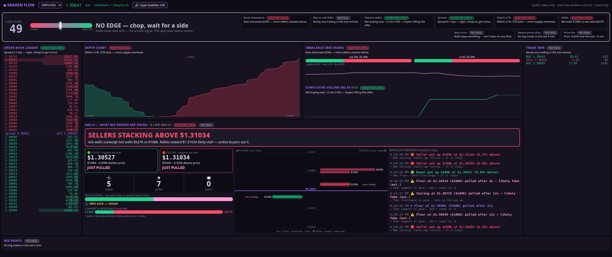
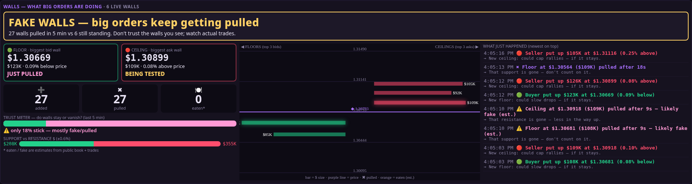
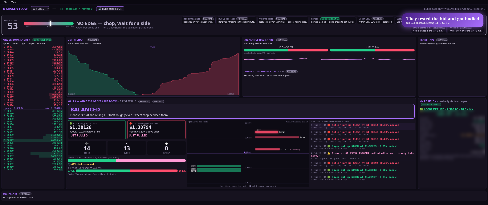
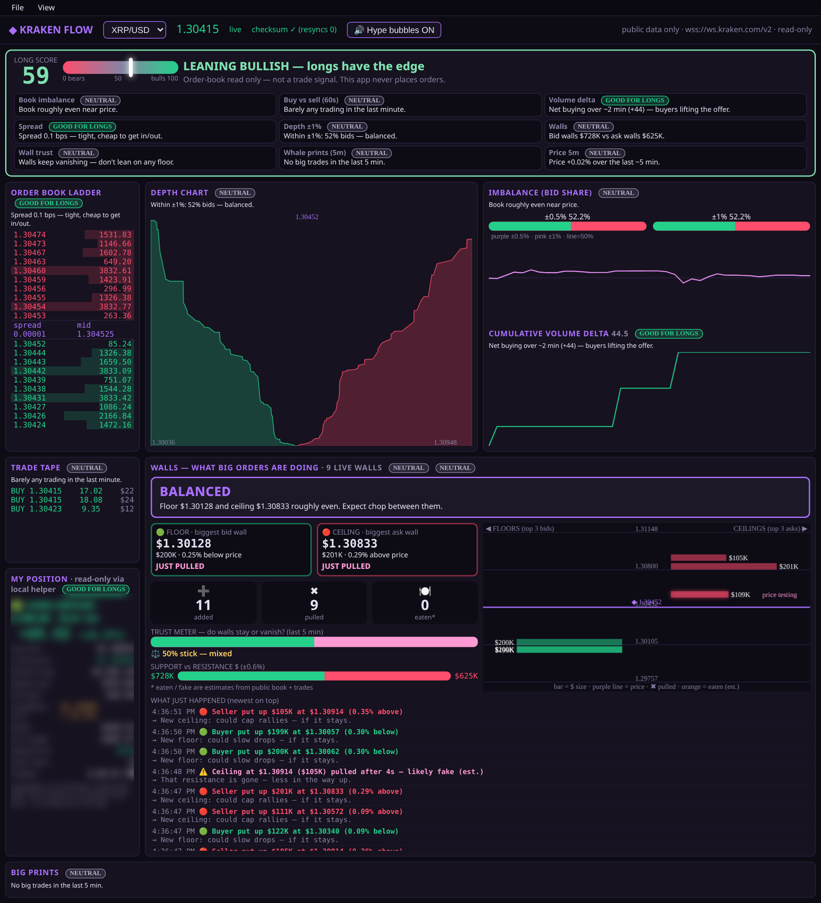
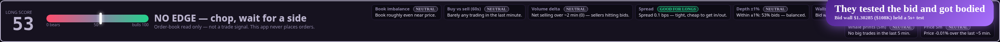
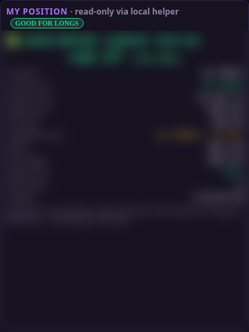
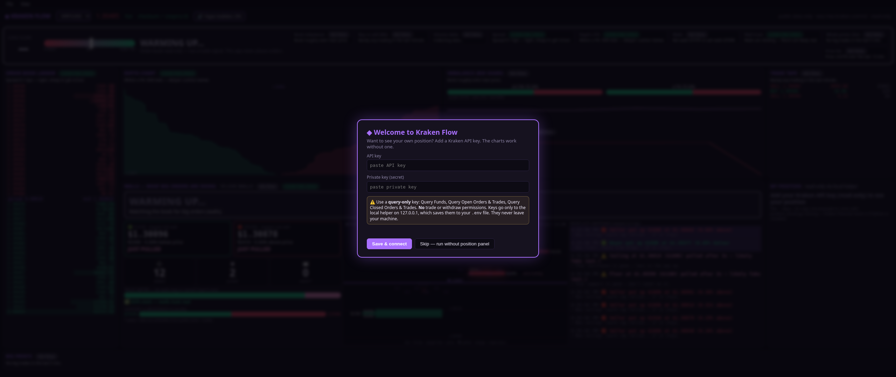
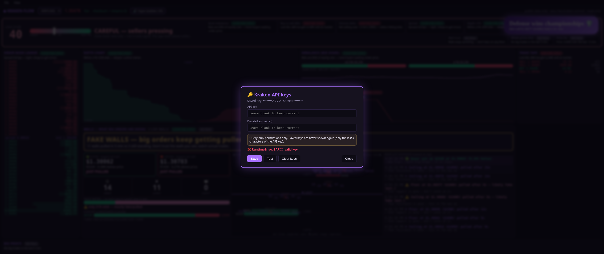

# ◆ Kraken Flow

A single-file, zero-install order-flow dashboard for Kraken, built for people who trade **long**.
It streams Kraken's **public** WebSocket v2 order book and trades and turns them into plain-English reads: who is defending, who is stacking, and whether the walls are real.

## Features
- **Long Score (0–100):** blends book imbalance, 60s buy/sell flow, volume delta, ±1% depth, wall balance, whale prints and 5-minute price change into one meter with a verdict like *BULLS IN CONTROL — longs favored* or *CAREFUL — sellers pressing*.
- **GOOD / BAD / NEUTRAL FOR LONGS tags** on every metric, each with a one-line "why".
- **Walls panel:** a headline verdict, Floor and Ceiling cards (price, $ size, distance, holding / being tested / pulled / eaten), a 5-minute tally of walls added, pulled and eaten, a trust meter, a top-3 wall ladder, and a plain-English event feed.
- **Hype bubbles** for big market buys, buy-delta surges and bid walls that hold a test, plus warning bubbles for big sells. They are rate-limited and can be muted.
- Order book ladder with CRC32 checksum verification and auto-resync, depth chart, imbalance and CVD charts, trade tape, and big prints.
- **My Position panel (optional):** pair, side, size, average entry, current price, unrealized P&L ($ and %), margin used, fees, an *estimated* liquidation price, equity, free margin, margin level, open-order count and last-updated time. It is read-only, has no trading buttons, and uses **your own** read-only key through a tiny local helper.
- **First-run setup screen and File → Keys…** to add, change, test or clear keys. Saved keys are only ever shown masked (last 4 characters).
- Works on ultrawide screens and still fits when snapped to a third of a 4K screen (about 1280px wide).
- Pairs: XRP/USD, BTC/USD, ETH/USD, SOL/USD.

| Walls | Hype bubble | 1/3 of 4K |
|---|---|---|
|  |  |  |

| Long Score | My Position (values blurred) | First-run setup | File → Keys… |
|---|---|---|---|
|  |  |  |  |

## Run
- **Any OS:** open `KrakenFlow.html` in a Chromium-based browser (Chrome or Edge).
- **Windows app window:** double-click `Kraken Flow.bat`. It opens Edge in app mode next to the HTML file. `KrakenFlow.ico` can be used as the icon for a shortcut.
  The launcher (`launcher.vbs` → `launcher.ps1`) runs hidden: it stops any old `position_server.py`, starts exactly one helper with `pythonw` (no console window), opens the app, and shuts the helper down when the Kraken Flow window closes. For a desktop shortcut, point it at `wscript.exe "<folder>\launcher.vbs"` with `KrakenFlow.ico` as the icon.

No build and no dependencies. The charts need no API keys.

## Optional: see your own position
1. On Kraken, go to **Settings → API** and create a key with **query-only** permissions: *Query Funds*, *Query Open Orders & Trades* and *Query Closed Orders & Trades*. Do **not** give it trade, withdraw or deposit permissions.
2. Either copy `.env.example` to `.env` and paste your key and secret, **or** skip this step and enter them in the app's setup screen or **File → Keys…**.
3. Run `python position_server.py` (Python 3.8+, standard library only). `Kraken Flow.bat` / `launcher.vbs` start it hidden automatically if Python is on your PATH, and stop it when the window closes.

How the helper handles your keys:
- It listens on **127.0.0.1:8787** only.
- It only accepts requests from the local page.
- It only calls `OpenPositions`, `TradeBalance` and `OpenOrders`.
- It strips out account IDs, txids and order IDs.
- It never sends the secret back.
- It writes `.env` with owner-only permissions. `.env` is gitignored.

If the helper isn't running or no key is set, the panel says *"Add your Kraken API key (read-only) to see your position"*. Choosing **Skip** on the setup screen hides the panel.

## Disclaimer
- **The charts read public market data only** (`wss://ws.kraken.com/v2`). The optional position helper makes **read-only** private calls with *your* query-only key, stored on your machine. **Nothing in this project places, edits or cancels orders.**
- The liquidation price is an **estimate**: it assumes Kraken's roughly 40% margin-level liquidation and that your other balances stay the same.
- **"Eaten" and "fake/spoof" labels are estimates** based on public book changes and trades. The Long Score and tags are heuristics.
- **This is not financial advice.** It is a read of the order book, not a trade signal. Use it at your own risk.

## License
MIT
