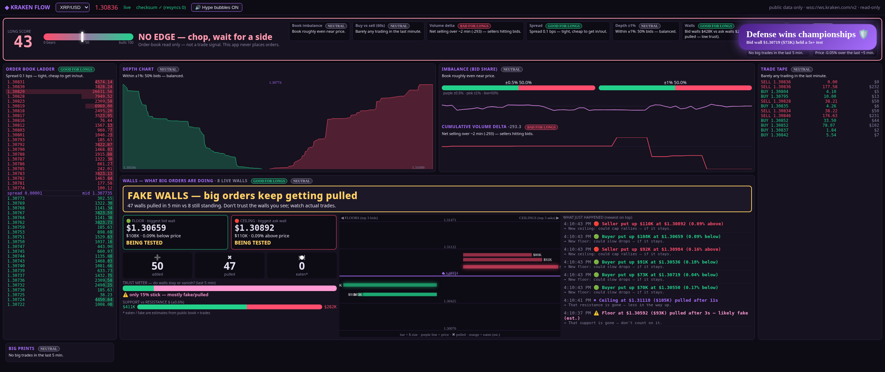

# ◆ Kraken Flow

A single-file, zero-install order-flow dashboard for Kraken, built for people who trade **long**.
It streams Kraken's **public** WebSocket v2 order book and trades and turns them into plain-English reads: who is defending, who is stacking, and whether the walls are real.

## Features
- **Long Score (0–100):** blends book imbalance, 60s buy/sell flow, volume delta, ±1% depth, wall balance, whale prints and 5-minute price change into one meter with a verdict like *BULLS IN CONTROL — longs favored* or *CAREFUL — sellers pressing*.
- **GOOD / BAD / NEUTRAL FOR LONGS tags** on every metric, each with a one-line "why".
- **Walls panel:** a headline verdict, Floor and Ceiling cards (price, $ size, distance, holding / being tested / pulled / eaten), a 5-minute tally of walls added, pulled and eaten, a trust meter, a top-3 wall ladder, and a plain-English event feed.
- **Hype bubbles** for big market buys, buy-delta surges and bid walls that hold a test, plus warning bubbles for big sells. They are rate-limited and can be muted.
- Order book ladder with CRC32 checksum verification and auto-resync, depth chart, imbalance and CVD charts, trade tape, and big prints.
- Works on ultrawide screens and still fits when snapped to a third of a 4K screen (about 1280px wide).
- Pairs: XRP/USD, BTC/USD, ETH/USD, SOL/USD.

| Walls | Hype bubble | 1/3 of 4K |
|---|---|---|
|  |  |  |

## Run
- **Any OS:** open `KrakenFlow.html` in a Chromium-based browser (Chrome or Edge).
- **Windows app window:** double-click `Kraken Flow.bat`. It opens Edge in app mode next to the HTML file. `KrakenFlow.ico` can be used as the icon for a shortcut.

No build, no dependencies, no API keys.

## Disclaimer
- **Reads public market data only** (`wss://ws.kraken.com/v2`). There is no private API, no keys and no account access, and it **places no orders**.
- **"Eaten" and "fake/spoof" labels are estimates** based on public book changes and trades. The Long Score and tags are heuristics.
- **This is not financial advice.** It is a read of the order book, not a trade signal. Use it at your own risk.

## License
MIT
